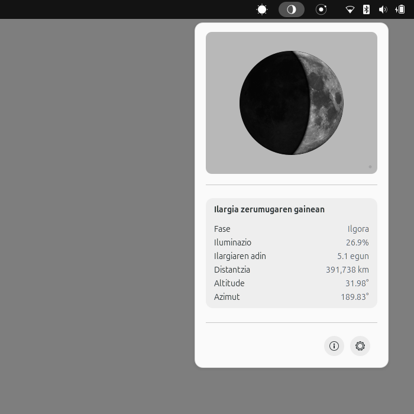
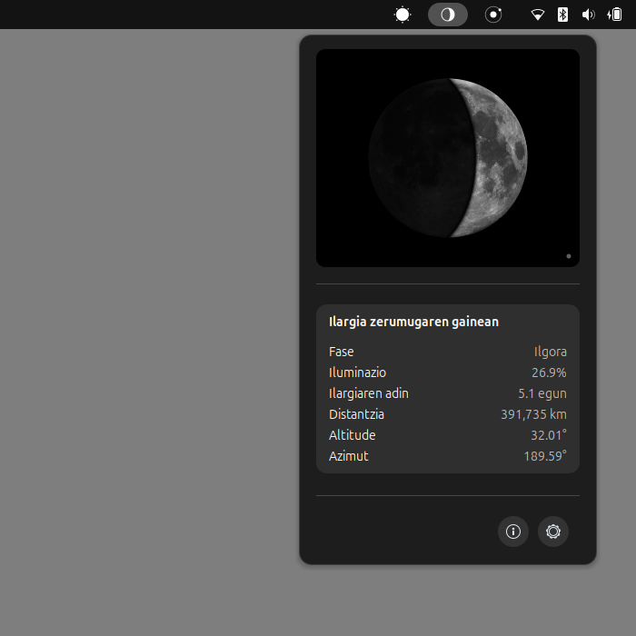

# Gnome Moon Extension 🌙

> **Version:** 1.0.0 | **GNOME Shell:** 46 – 50

**Gnome Moon Extension** is a GNOME Shell extension that displays the real-time lunar phase in the top panel.

Part of **Jakin | Athenaeum** — *A free knowledge desktop ecosystem for science, philosophy, and art.*

It offline-calculates the lunar phase, illumination fraction, synodic age, elevation, and azimuth using astronomical equations (Jean Meeus, "Astronomical Algorithms") based on your local coordinates. No external web requests are ever made.

---

## Preview 

| Light Mode (Day) | Dark Mode (Night) |
| :---: | :---: |
|  |  |

---

## Features

- **Top Bar Icon**: Minimalist lunar phase indicator rendered dynamically with Cairo, showing the exact current phase (new, crescent, quarter, gibbous, full) in real time.
- **Detailed Moon Diagram**: High-fidelity Cairo popover combining real-time phase vector geometry with an authentic lunar surface texture, earthshine shading, and atmospheric halo.
- **Astronomical Data**: Phase name, illumination percentage, synodic age (days), elevation, azimuth, and distance to the Moon.
- **Settings & Documentation**: A native Libadwaita Preferences window featuring configuration options, a detailed Information page with astronomical explanations, and an About section.
- **Cairo Vector Rendering**: Uses Cairo with vector drawing for a dynamic and interactive visual representation.
- **Completely Offline**: Runs 100% locally using Meeus algorithms — no network dependencies, no API calls.

---

## Panel Ordering and Ergonomics

The three astronomical extensions (Gnome Sun Extension, Gnome Moon Extension, and Gnome Planetarium Extension) feature an automatic sibling-ordering mechanism that guarantees a deterministic left-to-right sequence to the left of system status indicators:

`Gnome Sun Extension → Gnome Moon Extension → Gnome Planetarium Extension`

This spatial hierarchy respects Western left-to-right reading direction, human intuition, and cognitive ergonomics: starting at the daily solar cycle (primary circadian anchor), moving through Earth's immediate satellite (the Moon), and concluding at the macroscopic heliocentric scale (the Solar System).

---

## Supported Languages (3 languages)

GnomeMoon is fully translated into the following languages:

- **Basque** (`eu`)
- **English** (`en`)
- **Spanish** (`es`)

---

## Installation

Copy the extension directory to your GNOME Shell extensions directory:

```bash
cp -r GnomeMoonExtension ~/.local/share/gnome-shell/extensions/gnomemoonextension@aiurri.xyz
```

---

## Activation

### Via terminal:

```bash
gnome-extensions enable gnomemoonextension@aiurri.xyz
```

### Via GUI:
Open **GNOME Extensions** or **Extension Manager** and toggle *Gnome Moon Extension* on.

> **Note:** If on Wayland, you must log out and log back in to reload GNOME Shell before the extension becomes visible. On X11, you can restart it by typing `Alt+F2`, typing `r`, and hitting `Enter`.

---

## Configuration

1. Open the preferences of the extension (click on the gear icon in the Extensions app, or click *Settings* from the extension's top bar drop-down).
2. Enter your **latitude** and **longitude** in decimal degrees.
3. Configure the **refresh interval** (default is 60 seconds).

---

## License

GPL-3.0-or-later

---

## Credits

- Lunar calculations based on algorithms from Jean Meeus's "Astronomical Algorithms".
- Lunar surface texture by [Gregory H. Revera](https://commons.wikimedia.org/wiki/File:FullMoon2010.jpg) (CC BY-SA 3.0).

- Original idea by [Zuhaitz (Alberto V. I.)](http://www.aiurri.xyz), created with Google's Antigravity and VSCodium.
